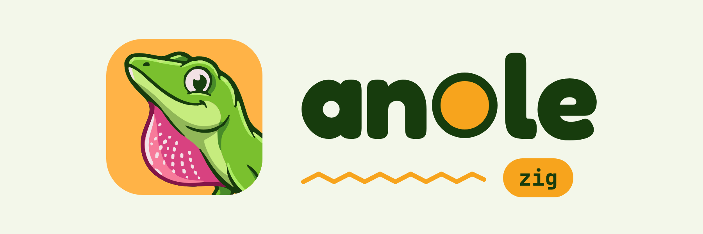
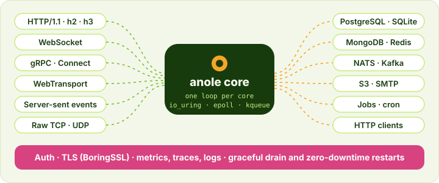

<div align="center">



**A backend framework for Zig, and a native server engine for Node and Python**

<a href="https://github.com/xuckless/anole/releases/latest"></a> <a href="https://github.com/xuckless/anole/actions/workflows/ci.yml"></a> <a href="https://ziglang.org/download/"></a> <a href="LICENSE"></a>

[Docs](https://xuckless.github.io/anole/) · [Getting started](https://xuckless.github.io/anole/getting-started/) · [API reference](https://xuckless.github.io/anole/api/) · [From Fiber](https://xuckless.github.io/anole/from-fiber/) · [Changelog](CHANGELOG.md)

</div>

## Requirements

- [Zig 0.17.x](https://ziglang.org/download/). Nothing else: Zig compiles every C dependency.
- Linux for production, macOS for development. Windows builds and passes its tests, but isn't tuned ([what it lacks](https://xuckless.github.io/anole/server/#windows)).

## Quick start

Get the `anole` CLI from the [latest release](https://github.com/xuckless/anole/releases/latest) (Linux, macOS, Windows; check it against `SHA256SUMS`), then:

```sh
anole new my-api          # templates: minimal, rest-postgres, realtime, grpc, full
cd my-api && zig build run
curl localhost:3000/      # {"hello":"world"}, OpenAPI page at /docs
```

Or by hand, in a `zig init` project:

```sh
zig fetch --save git+https://github.com/xuckless/anole#v0.5.4
```

```zig
// build.zig
pub fn build(b: *@import("std").Build) void {
    _ = @import("anole").addApp(b, .{ .name = "api", .root_source_file = b.path("src/main.zig") });
}
```

```zig
// src/main.zig
const std = @import("std");
const anole = @import("anole");

fn hello(_: *anole.Request, res: *anole.Response) !void {
    res.body = "Hello, World!";
}

pub fn main(init: std.process.Init) !void {
    var app = try anole.App.init(init.gpa, .{});
    defer app.deinit();
    app.get("/", hello);
    try app.listen(":3000"); // Ctrl-C drains and stops
}
```

[Templates](https://xuckless.github.io/anole/templates/) · [Getting started](https://xuckless.github.io/anole/getting-started/) walks on to JSON, WebSockets, TLS, gRPC and deployment.

## What Anole offers



One router, one runtime, one line per feature:

| | |
| --- | --- |
| **HTTP** | HTTP/1.1, HTTP/2 and HTTP/3 on one router, static files, TLS with hot reload · [routing](https://xuckless.github.io/anole/routing/) · [server](https://xuckless.github.io/anole/server/) |
| **Realtime** | WebSockets with rooms, WebTransport, server-sent events with replay · [WebSocket](https://xuckless.github.io/anole/websocket/) · [WebTransport](https://xuckless.github.io/anole/webtransport/) · [SSE](https://xuckless.github.io/anole/realtime/) |
| **gRPC** | server and client, gRPC-Web, Connect, JSON transcoding · [gRPC](https://xuckless.github.io/anole/grpc/) |
| **Auth** | JWT/JWKS, OIDC, sessions, CSRF, API keys, RBAC, rate limits · [auth](https://xuckless.github.io/anole/auth/) |
| **Data** | PostgreSQL, SQLite, MongoDB, Redis/Valkey; request deadlines, coalescing, caches · [databases](https://xuckless.github.io/anole/database/) |
| **Connectors** | NATS, Kafka, S3-compatible storage, SMTP · [messaging](https://xuckless.github.io/anole/messaging/) · [storage](https://xuckless.github.io/anole/storage/) · [email](https://xuckless.github.io/anole/email/) |
| **Background** | durable jobs, cron, signed webhooks in and out · [jobs](https://xuckless.github.io/anole/jobs/) · [cron](https://xuckless.github.io/anole/cron/) · [webhooks](https://xuckless.github.io/anole/webhooks/) |
| **Raw sockets** | TCP and UDP servers on the same runtime · [net](https://xuckless.github.io/anole/net/) |
| **Clients** | HTTP/1.1, /2 and /3 with retries and circuit breakers · [clients](https://xuckless.github.io/anole/clients/) |
| **DX** | typed config and `.env`, validation, OpenAPI, in-memory tests, a live console · [config](https://xuckless.github.io/anole/config/) · [validation](https://xuckless.github.io/anole/validation/) · [testing](https://xuckless.github.io/anole/testing/) · [console](https://xuckless.github.io/anole/console/) |
| **Ops** | Prometheus, OpenTelemetry, health checks, graceful drain, zero-downtime restarts, AWS Lambda · [observability](https://xuckless.github.io/anole/observability/) · [Lambda](https://xuckless.github.io/anole/lambda/) |
| **Node, Python** | a C ABI for anole-node and anole-py (in progress) · [C ABI](https://xuckless.github.io/anole/c-abi/) |

## Performance

<a href="https://github.com/MDA2AV/HttpArena/pull/1692"></a>

Ranks from [HttpArena](https://www.http-arena.com/), an independent benchmark, among all its entries (run saved in [PR #1692](https://github.com/MDA2AV/HttpArena/pull/1692)). My own harness: [`bench/`](https://github.com/xuckless/anole/tree/bench/suite/bench).

## Build flags

Every bundled library sits behind a flag, all on by default; what you switch off is never downloaded. `-Dprofile=minimal|web|full` sets them at once, single flags override it (`.features = .{ .kafka = false }` with `addApp`). Hello, World is about 1.3 MB minimal, 6 MB full.

<details>
<summary>All flags</summary>

| Flag | minimal | web | full (default) | Adds |
| --- | --- | --- | --- | --- |
| `-Dtls=boringssl\|none` | none | boringssl | boringssl | BoringSSL |
| `-Dhttp2=bool` | false | true | true | nghttp2 |
| `-Dhttp3=bool` | false | false | true | ngtcp2, nghttp3, WebTransport |
| `-Dcompression=bool` | false | true | true | zlib-ng, zstd |
| `-Dbrotli=bool` | false | true | true | Brotli responses (google/brotli); needs `-Dcompression` |
| `-Dlibdeflate=bool` | false | true | true | libdeflate for buffered gzip responses; needs `-Dcompression` |
| `-Dgrpc=bool` | false | false | true | gRPC, zig-protobuf (and protoc for codegen) |
| `-Dwebsocket=bool` | false | true | true | WebSocket |
| `-Dauth=bool` | false | true | true | JWT, OIDC, CSRF, passwords, API keys, RBAC |
| `-Djson=bool` | false | true | true | yyjson |
| `-Dredis=bool` | false | false | true | hiredis (Redis/Valkey client, stores) |
| `-Dpostgres=bool` | false | true | true | PostgreSQL client (pg.zig fork) |
| `-Dsqlite=bool` | false | true | true | SQLite (amalgamation, zig-sqlite fork) |
| `-Dmongodb=bool` | false | false | true | MongoDB client and BSON |
| `-Dopenapi=bool` | false | true | true | OpenAPI 3.1 documents and the docs page (pure Zig) |
| `-Dnats=bool` | false | false | true | NATS client (pure Zig) |
| `-Dkafka=bool` | false | false | true | Kafka client, lz4; needs `-Dcompression` |
| `-Dconsole=bool` | false | true | true | the live console (control socket and terminal UI) |
| `-Dnet=bool` | false | true | true | raw TCP and UDP servers (pure Zig) |
| `-Djobs=bool` | false | true | true | durable jobs and cron (pure Zig) |
| `-Dwebhooks=bool` | false | true | true | webhooks out and the verify middleware; needs `-Djobs` |
| `-Ds3=bool` | false | true | true | S3-compatible object storage client (pure Zig) |
| `-Dsmtp=bool` | false | true | true | SMTP client for sending mail (pure Zig) |
| `-Dlambda=bool` | true | true | true | the AWS Lambda adapter (pure Zig) |

gRPC needs HTTP/2, HTTP/3 needs TLS, Brotli/libdeflate/Kafka need compression, webhooks need jobs; asking for one without the other is an error.

</details>

## Develop

```sh
zig build test          # unit and smoke tests
zig build test-flags    # every preset and flag combination
zig build run-full      # every listener: 8080 (h1, h2c), 8443 (TLS, h2, h3)
zig build docs          # API reference in zig-out/docs
```

Examples run with `zig build run-<name>`: `hello`, `rest`, `websocket`, `grpc`, `auth`, `postgres`, `sqlite`, `mongodb`, `redis`, `net`, `io`, `lambda`, `full`.

## Status

Pre-1.0; the latest release is [0.5.4](CHANGELOG.md), and the API may still change. Next: hardening for 1.0, then the anole-node and anole-py bindings.

Anole stands on [zio](https://github.com/lalinsky/zio), [dusty](https://github.com/lalinsky/dusty) (adapted as its HTTP core), nghttp2, ngtcp2, nghttp3 and BoringSSL. Bugs and ideas: [Issues](https://github.com/xuckless/anole/issues/new/choose); questions: [Discussions](https://github.com/xuckless/anole/discussions); security: [SECURITY.md](SECURITY.md).

## License

[MIT](LICENSE). Bundled components are MIT, Apache-2.0, Zlib or BSD, listed in [THIRD_PARTY_NOTICES](THIRD_PARTY_NOTICES).
