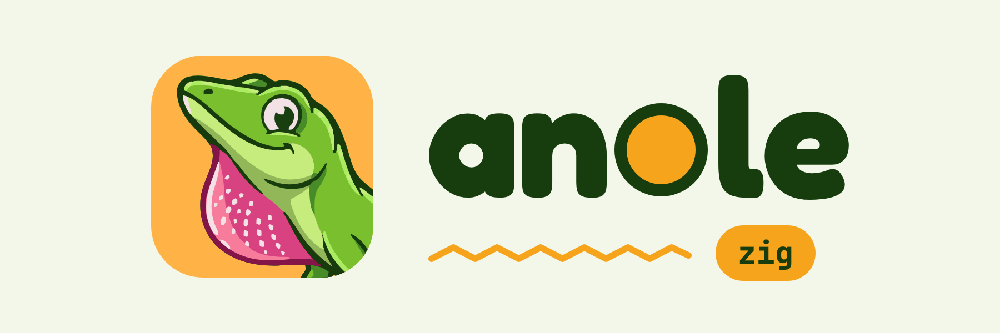

<p align="center">
  
</p>

<h3 align="center">Anole is a backend framework for Zig, and a native server engine for Node and Python.</h3>

<p align="center">
  <a href="LICENSE"></a>
  <a href="https://ziglang.org/download/"></a>
  
  
  
  
  
  
  
  <a href="https://xuckless.github.io/anole/"></a>
  <a href="https://github.com/xuckless/anole/stargazers"></a>
</p>

<p align="center">
  <a href="https://xuckless.github.io/anole/">Docs</a> ·
  <a href="https://xuckless.github.io/anole/getting-started/">Getting started</a> ·
  <a href="https://xuckless.github.io/anole/api/">API reference</a> ·
  <a href="https://github.com/xuckless/anole/wiki">Wiki</a> ·
  <a href="https://zigistry.dev/packages/github/xuckless/anole">Zigistry</a> ·
  <a href="CHANGELOG.md">Changelog</a>
</p>


## What Anole offers

1. **REST:** HTTP/1.1, HTTP/2 and HTTP/3, one router for all three ([routing](https://xuckless.github.io/anole/routing/), [server](https://xuckless.github.io/anole/server/)).
2. **WebSockets:** over HTTP/1.1, HTTP/2 and HTTP/3, with rooms and topics ([docs](https://xuckless.github.io/anole/websocket/)).
3. **gRPC:** server and client over HTTP/2, HTTP/3 and Unix sockets, plus gRPC-Web, Connect and JSON transcoding ([docs](https://xuckless.github.io/anole/grpc/)).
4. **WebTransport:** over HTTP/3 (draft-02), streams and datagrams ([docs](https://xuckless.github.io/anole/webtransport/)).
5. **Server-sent events:** topics published once to every subscriber, replay after a reconnect, and `watch` to stream database changes into SSE and WebSocket topics ([docs](https://xuckless.github.io/anole/realtime/)).
6. **Raw TCP and UDP:** custom protocols on the same runtime, with TLS and the PROXY protocol ([docs](https://xuckless.github.io/anole/net/)).
7. **Background work:** durable jobs with retries and delays, cron, and webhooks out (signed, retried) and in (Stripe, GitHub, Slack) ([jobs](https://xuckless.github.io/anole/jobs/), [cron](https://xuckless.github.io/anole/cron/), [webhooks](https://xuckless.github.io/anole/webhooks/)).
8. **Auth:** JWT and JWKS, OIDC sign-in, sessions, CSRF, API keys, RBAC and rate limits ([docs](https://xuckless.github.io/anole/auth/)).
9. **Databases:** PostgreSQL, SQLite, MongoDB and Redis/Valkey, with request deadlines and transactions; MySQL/MariaDB is planned ([docs](https://xuckless.github.io/anole/database/)).
10. **Messaging and connectors:** NATS and Kafka, S3-compatible object storage and SMTP email ([messaging](https://xuckless.github.io/anole/messaging/), [storage](https://xuckless.github.io/anole/storage/), [email](https://xuckless.github.io/anole/email/)).
11. **Caching built in:** request coalescing, a TTL result cache and an HTTP response cache ([docs](https://xuckless.github.io/anole/database/)).
12. **TLS everywhere:** BoringSSL with mutual TLS, hot certificate reload and 0-RTT on HTTP/3 ([server](https://xuckless.github.io/anole/server/)).
13. **Developer tools:** typed config and `.env` files, validation, OpenAPI, in-memory tests, `anole new` and a live console ([config](https://xuckless.github.io/anole/config/), [validation](https://xuckless.github.io/anole/validation/), [console](https://xuckless.github.io/anole/console/)).
14. **Observability:** structured logs, Prometheus metrics, OpenTelemetry tracing and health checks ([docs](https://xuckless.github.io/anole/observability/)).
15. **Outbound clients:** HTTP/1.1, HTTP/2 and HTTP/3 clients on the same TLS stack, with retries and circuit breakers ([docs](https://xuckless.github.io/anole/clients/)).
16. **Operations:** graceful drain, zero-downtime restarts, systemd socket activation, the PROXY protocol, and the same app on AWS Lambda ([server](https://xuckless.github.io/anole/server/), [Lambda](https://xuckless.github.io/anole/lambda/)).
17. **Node and Python:** a C ABI that lets Node and Python apps run on Anole's engine; the bindings, anole-node and anole-py, are on the way ([docs](https://xuckless.github.io/anole/c-abi/)).

Anole doesn't reinvent the hard parts. It stands on libraries that have
already survived the internet:
- [zio](https://github.com/lalinsky/zio) for async I/O;
- [dusty](https://github.com/lalinsky/dusty) for HTTP, adapted into Anole as its HTTP core;
- [zig-protobuf](https://github.com/Arwalk/zig-protobuf) for protobuf generation;
- nghttp2 for HTTP/2;
- BoringSSL for TLS;
- ngtcp2 and nghttp3 for HTTP/3.

Anole wires them together, tunes them hard, and hands you a Fiber-sized API.
The goal is that building a backend in Zig feels as easy as in Express, Fiber
or Bun: one call per feature, sane defaults, clear errors, and databases,
auth and observability already in the box.

Zig compiles every C dependency, so you install nothing but Zig. Each one
sits behind a build flag, and whatever you switch off is never downloaded or
compiled.

## Start from a template

`anole new my-api` makes a project (a JSON API, a PostgreSQL API, a chat, a gRPC
service, or most of Anole in one app) with tests, an OpenAPI page at `/docs`
and a ready `.env`; see [docs/templates.md](docs/templates.md) for the
download. The sections below build the same thing by hand.

## Hello, World

```zig
const std = @import("std");
const anole = @import("anole");

fn hello(_: *anole.Request, res: *anole.Response) !void {
    res.body = "Hello, World!";
}

pub fn main(init: std.process.Init) !void {
    var app = try anole.App.init(init.gpa, .{});
    defer app.deinit();
    app.get("/", hello);
    try app.listen(":3000"); // HTTP/1.1 and HTTP/2; Ctrl-C drains and stops
}
```

That's the whole server. To try it:

1. In a project made with `zig init`, run
   `zig fetch --save git+https://github.com/xuckless/anole#v0.4.1`
   (or a later tag, or a commit).
2. Make `build.zig` one call:
   `@import("anole").addApp(b, .{ .name = "api", .root_source_file = b.path("src/main.zig") })`.
3. `zig build run`, then `curl localhost:3000/`.

The rest is one line each:

```zig
app.ws("/echo", echo);                                    // WebSockets (HTTP/1.1, /2 and /3)
app.grpc(pb.Greeter, .{ .SayHello = sayHello });          // gRPC, gRPC-Web, Connect, JSON transcoding
app.webtransport("/wt", session);                         // WebTransport
try app.staticDir("/", "public", .{});                    // static files, ranges, ETags
const db = try app.postgres(.{});                         // PostgreSQL from DATABASE_URL (also sqlite, mongodb, redis)
const live = try app.sseTopics(.{});                      // server-sent events: publish once, replay on reconnect
app.sse("/live", live, .{ .topics = &.{"news"} });
const jobs = try app.jobs(.{ .store = .{ .postgres = db } }); // durable background jobs, cron and webhooks on top
const files = try app.s3(.{});                            // S3, R2, MinIO (and app.smtp for email)
try app.tcp(":7000", Echo, .{});                          // raw TCP (and app.udp) beside HTTP
app.metrics(.{}); app.health(.{}); app.tracing(.{});      // Prometheus, health checks, OpenTelemetry
try app.listenTls(":443", .fromFiles("cert.pem", "key.pem")); // HTTPS + HTTP/2 + HTTP/3
```

Handlers make async calls through `req.io`: outbound HTTP, files, timers,
anything on `std.Io`. A call that waits suspends that one request, never the
core it runs on. When you want every knob, `anole.Server(App)` takes each
listener and option explicitly ([docs/server.md](docs/server.md)).

Where to go next:
- [Getting started](https://xuckless.github.io/anole/getting-started/) walks
  from `zig init` to a JSON API, WebSockets, TLS, gRPC and a deployment.
- [From Fiber](https://xuckless.github.io/anole/from-fiber/) puts Fiber's API
  next to Anole's, for Go developers.
- `zig build run-rest` runs a JSON CRUD API with API-key auth.

## Performance

Anole is built to be fast and small: per-core event loops on io_uring or
epoll, requests that arrive whole run without a task of their own, batched
writes on every protocol, and idle connections that hold almost no memory.
Rather than quote my own numbers, I entered Anole in
[HttpArena](https://www.http-arena.com/), an independent benchmark that runs
every framework on the same hardware with the same rules. Its current ranks
(the listed entry is an early release, v0.1.2):

<p align="center">
  <a href="https://www.http-arena.com/#scope=h1"></a>
  <a href="https://www.http-arena.com/#scope=h2"></a>
  <a href="https://www.http-arena.com/#scope=h3"></a>
  <a href="https://www.http-arena.com/#scope=grpc"></a>
  <a href="https://www.http-arena.com/#scope=ws"></a>
</p>

My own harness and raw results live in `bench/` on the
[`bench/suite`](https://github.com/xuckless/anole/tree/bench/suite/bench)
branch.

## What's in the box

Everything below builds and passes its tests on macOS (arm64) and Linux
(x86_64), and cross-compiles for aarch64 Linux.

- **HTTP/1.1:** a fast server and router (dusty on zio) with:
  - path parameters, nested groups and middleware: request IDs, access log,
    compression, CORS, sessions;
  - static files with ranges, ETags and precompressed variants;
  - per-phase timeouts and body limits, keep-alive and pipelining;
  - no allocation per request on a warm connection.
- **HTTP/2 on nghttp2:** over TLS and cleartext, with streaming bodies,
  trailers and a two-phase GOAWAY drain. It passes all 147 h2spec cases in
  strict mode.
- **HTTP/3 on ngtcp2 and nghttp3:** with:
  - Retry, stateless reset, QUIC v2, ECN, resumption;
  - replay-safe opt-in 0-RTT and connection migration;
  - one UDP socket per core with connection-ID steering on Linux;
  - a client.

  It passes every QUIC interop runner case it takes, against both ngtcp2's
  and quic-go's clients.
- **TLS on BoringSSL:**
  - TLS 1.3 and 1.2, ALPN, mutual TLS (over HTTP/3 too), session tickets;
  - hot certificate reload on SIGHUP.
- **WebSockets:** over HTTP/1.1, HTTP/2 (RFC 8441, opt-in) and HTTP/3
  (RFC 9220), with permessage-deflate and a rooms helper for broadcast. It passes all
  517 Autobahn cases.
- **WebTransport (draft-02):** streams both ways, datagrams, close codes and
  drain, on the same router, plus a client. It's checked against aioquic and
  in the interop runner.
- **gRPC:**
  - server and client, all four call modes, over HTTP/2 and HTTP/3 (checked
    against grpc-dotnet both ways), and over Unix sockets between processes
    on one host;
  - gRPC-Web, Buf's Connect protocol, JSON transcoding from
    `google.api.http`, and `grpc.health.v1`.

  It passes grpc-go's interop suite both ways. `zig build` runs protoc for
  you.
- **Auth:**
  - JWT and JWKS with pinned algorithms;
  - OIDC sign-in with Google and Apple presets;
  - sessions (memory, Redis or sealed cookies), CSRF, Argon2id, API keys,
    RBAC and rate limiting.
- **Observability:** Prometheus `/metrics`, OpenTelemetry traces, structured
  access logs, `/healthz` and `/readyz`; JSON Lines logs by default in
  production, `req.log()` with request and trace ids, and readable startup
  errors.
- **Input and tests:** validation with 422 `application/problem+json` that
  names every field, typed handlers (`anole.In`) checked at compile time,
  and in-memory tests (`anole.testing`) with no socket.
- **Operations:**
  - graceful drain;
  - zero-downtime restart on SIGUSR2, where the new process inherits every
    socket, QUIC included;
  - systemd socket activation and `Type=notify`;
  - the PROXY protocol and `X-Forwarded-*`.
- **Clients:** HTTP/1.1, HTTP/2 and HTTP/3 clients (HTTP/2 by default where
  the server offers it, one shared connection per origin and core), plus
  Redis/Valkey, all on the same TLS stack.
- **Databases:** built-in connectors, so a handler can query without a
  third-party driver and without blocking its core:
  - PostgreSQL, on a fork of pg.zig moved to `std.Io`, over the same
    BoringSSL stack;
  - SQLite, the amalgamation built by Zig, with one writer thread per
    database and reads on the blocking pool;
  - MongoDB, Anole's own client on the drivers' specifications (OP_MSG,
    SCRAM, replica-set discovery, retryable writes) with a Zig BSON codec;
  - Redis and Valkey (plain or TLS), with pipelines, `acquire` for
    WATCH/MULTI and pub/sub, under the same shape (`-Dredis`);
  - one shared shape: a pool per core, calls take the request first
    (`db.all(Post, req, sql, .{args})`), request deadlines cancel queries,
    errors become HTTP statuses, and rows land in the request's arena;
  - opt-in request coalescing and short-lived result caches, off unless
    asked for;
  - behind `-Dpostgres`, `-Dsqlite`, `-Dmongodb` and `-Dredis`.
- **Messaging:** NATS (publish, request/reply, handlers, JetStream) and
  Kafka (producer and consumer groups), Anole's own clients
  ([messaging](docs/messaging.md)).
- **Config and tooling:** typed settings from the environment and `.env`
  files, deployment modes (standalone, behind a proxy, a platform such as
  Cloud Run, AWS Lambda), OpenAPI 3.1 documents with a `/docs` page, the
  `anole` command line with project templates, and a live console that
  attaches to a running app ([config](docs/config.md),
  [console](docs/console.md)).
- **Object storage:** an S3 client for AWS S3, R2, MinIO, B2 and Supabase
  Storage, with presigned URLs and multipart uploads ([storage](docs/storage.md)).
- **Email:** SMTP with STARTTLS or TLS, HTML, attachments and a pool per
  core ([email](docs/email.md)).
- **Server-sent events:** topics published once to every subscriber, replay
  after a reconnect, and `anole.watch` for database changes ([realtime](docs/realtime.md)).
- **Background jobs:** queues with retries, backoff, delays and workers, in
  memory or SQLite ([jobs](docs/jobs.md)).
- **Cron:** schedules on the job queue, one job per tick across instances
  ([cron](docs/cron.md)).
- **Webhooks:** signed and retried delivery out, verification presets for
  Stripe, GitHub and Slack in ([webhooks](docs/webhooks.md)).
- **TCP and UDP servers:** raw protocols on the same runtime and listeners,
  with TLS and the PROXY protocol ([net](docs/net.md)).
- **AWS Lambda:** the same app served from the Lambda Runtime API with
  `deployment = .lambda` ([lambda](docs/lambda.md)).

**Status: pre-1.0; the latest release is 0.4.1** ([CHANGELOG.md](CHANGELOG.md)).
The API may still change before 1.0. Known issues and limitations are tracked in
[Issues](https://github.com/xuckless/anole/issues). Next: the Node and
Python bindings, anole-node (TypeScript) and anole-py (ASGI and WSGI), on the
C ABI that ships today.

## Requirements

- Zig **0.17.x** (tested on 0.17.0). The build stops with a clear error on
  any other minor version and on 0.17 dev builds.
- Linux or macOS. Production is Linux; macOS is for development.
- Windows (x86_64) is a development target: Anole builds there with every
  feature, runs, and passes its tests on CI, so an app can be written and
  tested on Windows. It is not tuned for production there, and a few
  Unix-only parts are compiled out
  ([what Windows lacks](docs/server.md#windows)). To serve from a Windows
  machine, run the Linux build in WSL2 or Docker.

## Build and test

```sh
zig build test          # unit tests plus smoke tests for the enabled features
zig build test-flags    # the tests for every preset and edge flag combination
zig build run-hello     # Hello, World! on http://localhost:3000
zig build run-rest      # examples/rest, a JSON API on port 3000
zig build run-full      # every listener: 8080 (HTTP/1.1, h2c), 8443 (HTTPS, HTTP/3)
zig build run-io        # handlers waiting on timers, files and outbound requests (port 8081)
zig build docs          # the API reference (Zig autodoc) in zig-out/docs
```

A passing test's log lines stay hidden; a failing one shows them. CI runs
the tests with `--test-timeout 120s`: a test still running at 110 s is taken
for a hang, and the test runner prints its name and every thread's backtrace
(gdb on Linux, lldb or `sample` on macOS) before the limit ends it.
`zig build hang-probe --test-timeout 20s` with `ANOLE_TEST_DUMP_AFTER=5`
shows what that looks like.

`examples/full` speaks HTTP/1.1 and HTTP/2 on both ports and HTTP/3 on 8443
over UDP:
- `curl --http2-prior-knowledge localhost:8080/` and `curl -k --http2 https://localhost:8443/` both return `hello`;
- `curl localhost:8080/users/42` returns `user 42`;
- `POST /echo` streams the request body back.

Its certificate is self-signed, generated at startup and only kept in
memory, so `-k` it. Pass other ports with `zig build run-full -- 9000 9443`.

## Build flags

`-Dprofile` sets everything at once, and individual flags override it.

| Flag | minimal | web | full (default) | Adds |
| --- | --- | --- | --- | --- |
| `-Dtls=boringssl\|none` | none | boringssl | boringssl | BoringSSL |
| `-Dhttp2=bool` | false | true | true | nghttp2 |
| `-Dhttp3=bool` | false | false | true | ngtcp2, nghttp3, WebTransport |
| `-Dcompression=bool` | false | true | true | zlib-ng, zstd |
| `-Dbrotli=bool` | false | true | true | Brotli responses (google/brotli); needs `-Dcompression` |
| `-Dgrpc=bool` | false | false | true | gRPC, zig-protobuf (and protoc for codegen) |
| `-Dwebsocket=bool` | false | true | true | WebSocket |
| `-Dauth=bool` | false | true | true | JWT, OIDC, CSRF, passwords, API keys, RBAC |
| `-Djson=bool` | false | true | true | yyjson |
| `-Dredis=bool` | false | false | true | hiredis (Redis/Valkey client, stores) |
| `-Dpostgres=bool` | false | true | true | PostgreSQL client (pg.zig fork) |
| `-Dsqlite=bool` | false | true | true | SQLite (amalgamation, zig-sqlite fork) |
| `-Dmongodb=bool` | false | false | true | MongoDB client and BSON |
| `-Dopenapi=bool` | false | true | true | OpenAPI 3.1 documents and the docs page (pure Zig) |
| `-Dnats=bool` | false | false | true | NATS client (pure Zig) |
| `-Dkafka=bool` | false | false | true | Kafka client, lz4; needs `-Dcompression` |
| `-Dconsole=bool` | false | true | true | the live console (control socket and terminal UI) |
| `-Dnet=bool` | false | true | true | raw TCP and UDP servers (pure Zig) |
| `-Djobs=bool` | false | true | true | durable jobs and cron (pure Zig) |
| `-Dwebhooks=bool` | false | true | true | webhooks out and the verify middleware; needs `-Djobs` |
| `-Ds3=bool` | false | true | true | S3-compatible object storage client (pure Zig) |
| `-Dsmtp=bool` | false | true | true | SMTP client for sending mail (pure Zig) |
| `-Dlambda=bool` | true | true | true | the AWS Lambda adapter (pure Zig) |

Constraints:
- gRPC needs HTTP/2, so `-Dhttp2=false` turns gRPC off. Asking for both
  `-Dhttp2=false` and `-Dgrpc=true` is an error.
- HTTP/3 needs TLS, so `-Dtls=none` turns HTTP/3 off. Asking for both
  `-Dtls=none` and `-Dhttp3=true` is an error.
- Brotli and Kafka need `-Dcompression`, and webhooks need `-Djobs`, in the
  same way: switching the first off switches them off, and asking for both
  is an error.

`-Ddefault-deployment` sets the deployment a build falls back on when neither
the options nor `ANOLE_DEPLOYMENT` name one (`zig build lambda` builds with
`lambda`). With `addApp`, `.features = .{ .kafka = false }` turns single
features on or off over the preset.

In code, the chosen flags are `anole.features`. A minimal build of
Hello, World is about 1.3 MB; everything on is about 6 MB.

## Using Anole as a dependency

```sh
zig fetch --save git+https://github.com/xuckless/anole#v0.4.1
```

Any later tag (see the [releases](https://github.com/xuckless/anole/releases))
or a commit works the same way.

A complete `build.zig`, with gRPC code generated from a `.proto` as part of
`zig build` (no extra step, nothing to commit):

```zig
const std = @import("std");

pub fn build(b: *std.Build) void {
    _ = @import("anole").addApp(b, .{
        .name = "api",
        .root_source_file = b.path("src/main.zig"),
        .protos = &.{.{ .name = "greeter_pb", .file = b.path("proto/greeter.proto") }}, // optional
    });
}
```

`addApp` also takes `target`, `optimize` and `.profile = .web`. By hand:

```zig
const anole = b.dependency("anole", .{ .target = target, .optimize = optimize, .profile = .web });
exe.root_module.addImport("anole", anole.module("anole"));
```

Use the `git+https` form, because Zig 0.17.0's `zig fetch` mishandles
tarball URLs. `addProtoModule` and `addProtoGen` cover other protobuf setups
([docs/grpc.md](docs/grpc.md)). `tests/consumer` is a complete small project
set up this way, and CI builds it from an empty cache on every push.

## Documentation

- **[xuckless.github.io/anole](https://xuckless.github.io/anole/)**: the
  guides, with search, and the [API reference](https://xuckless.github.io/anole/api/)
  generated from the source's doc comments. The same guides are in
  [`docs/`](docs/) and on the [wiki](https://github.com/xuckless/anole/wiki).
- Guides: [getting started](docs/getting-started.md),
  [routing](docs/routing.md), [validation](docs/validation.md), [the
  server](docs/server.md), [config](docs/config.md),
  [WebSocket](docs/websocket.md), [WebTransport](docs/webtransport.md),
  [gRPC](docs/grpc.md), [clients](docs/clients.md),
  [databases](docs/database.md), [messaging](docs/messaging.md),
  [storage](docs/storage.md), [email](docs/email.md), [server-sent
  events](docs/realtime.md), [jobs](docs/jobs.md), [cron](docs/cron.md),
  [webhooks](docs/webhooks.md), [TCP and UDP](docs/net.md),
  [resilience](docs/resilience.md), [auth](docs/auth.md),
  [observability](docs/observability.md), [logging](docs/logging.md), [the
  console](docs/console.md), [testing](docs/testing.md),
  [OpenAPI](docs/openapi.md), [templates](docs/templates.md), [AWS
  Lambda](docs/lambda.md), [from Fiber](docs/from-fiber.md),
  [migrating](docs/migrating.md) and [the C ABI](docs/c-abi.md).
- Examples, each runnable with `zig build run-<name>`: `hello`, `rest`,
  `websocket`, `net`, `grpc`, `auth`, `clients`, `observe`, `io`,
  `postgres`, `sqlite`, `mongodb`, `redis`, `lambda`, and `full` (every
  listener and option spelled out).
- [CHANGELOG.md](CHANGELOG.md) and [MAINTAINING.md](MAINTAINING.md): pins,
  forks, the Zig version policy, releases.

## Contributing and security

Bug reports and feature requests are welcome in
[Issues](https://github.com/xuckless/anole/issues/new/choose); questions go to
[Discussions](https://github.com/xuckless/anole/discussions). Please report
security problems privately, as [SECURITY.md](SECURITY.md) describes.

## Licence

MIT; see [LICENSE](LICENSE). Anole fetches and links components under MIT,
Apache-2.0, Zlib and BSD licences, all listed in
[THIRD_PARTY_NOTICES](THIRD_PARTY_NOTICES). It owes a lot to their authors.
